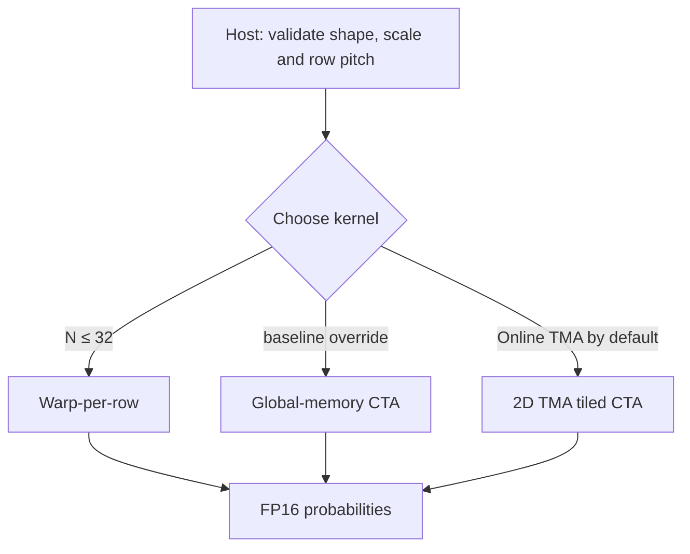
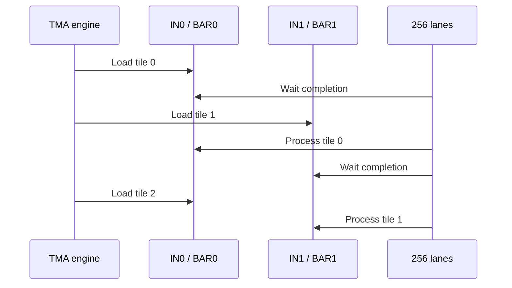

# Architecture and execution

This project accepts **precomputed** FP16 attention scores, not `Q`, `K` or `V`. Every output row is a causal, numerically stable softmax computed with FP32 intermediates and rounded to FP16. The merged device source has assembled for Blackwell `sm_100a` but still needs actual GPU execution and runtime validation.

## Kernel choices

| Symbol | CTA mapping | Data movement | Use |
|---|---|---|---|
| `causal_softmax_baseline` | One row, 256 lanes | Global memory | Independent control implementation; simple 8-warp max/sum reductions |
| `causal_softmax_warp` | Eight rows, one warp/row | Global memory | `1 <= N <= 32`; one warp reduction per row |
| `causal_softmax_tma` | Four rows, 256 columns/tile | 2D TMA to one shared input tile; 2D TMA store | Single-buffer TMA control |
| `causal_softmax_tma_pipelined` | Four rows, 256 columns/tile | 2D TMA and two alternating input tiles | Attempt to overlap loading next tile with math on the current tile |
| `causal_softmax_tma_online` | Eight rows, one warp/row, 128 columns/tile | 2D TMA and two alternating FP16 input tiles | Online maximum and denominator, then output; two passes |

All blocks use 256 threads (eight warps). The three-pass TMA kernels assign four rows to the CTA; each lane handles the same column of four different rows and all eight warps reduce each row. The online kernel assigns **one row to each warp**; lane `l` handles columns `l,l+32,l+64,l+96` within a 128-column tile, exposing four independent values. The host constructs **two independent TMA descriptor pairs** (`4×256` and `8×128`) because geometry is encoded in each descriptor. It pads FP16 row pitch to a multiple of eight (16 B). Out-of-bounds positions are masked; padded warps still join CTA barriers, and descriptor bounds suppress invalid row stores.

## Fused numerical procedure

For row `r`, score column `c` is valid iff `c <= r`. For each valid score, let `z = f32(score) * scale`.

1. **Maximum:** `m = max(z)` across all valid columns. Invalid columns contribute negative infinity.
2. **Denominator:** `d = sum(exp(z - m))` across valid columns. GPU uses the approximate FP32 `ex2.approx.f32((z-m)*log2(e))` instruction.
3. **Output:** valid `p = f16(exp(z-m)/d)`; invalid `p = +0.0_f16`.

For every real row, column zero is eligible. The baseline, narrow warp kernel, and first two TMA designs each read the input three times. The online TMA variant computes **running maximum and denominator together**, reloading inputs only once for normalization. No variant materializes a full-row global scratch tensor.

## Two-pass online update

For a tile, let `t` be the maximum eligible scaled score, with previous row statistics `(m, l)`. The next state is:

\[
m' = \max(m,t),\qquad l' = l\,e^{m-m'} + \sum_{j\text{ eligible in tile}} e^{x_j-m'}.
\]

Start with `m = -∞`, `l = 0`. Entirely masked tiles and invalid rows **skip the numerical update** to avoid `-∞ - -∞`; the present kernel still **issues the TMA input copy** for every tile on both passes. Causal masking is applied after loading, so it does not eliminate source traffic. Avoiding fully masked TMA copies would require a redesigned producer/barrier schedule and GPU validation. Every valid lane of a warp receives the same maximum and sum through XOR-butterfly shuffles. Pass two recomputes probabilities from the stored `(m,l)` state, writes FP16 values to shared memory, fences for the TMA proxy, and waits for S2G completion. The CPU execution model in `reference/src/online.rs` independently checks the recurrence with 32-lane reductions and ragged tiles.

## Double-buffer schedule

For each pass, tiles 0..K-1 alternate between `IN0/BAR0` and `IN1/BAR1`. The three-pass pipeline has **256 arrivals** per barrier phase and token waits; the online kernel has **one producer arrival** (thread zero) and parity waits, with all other threads acting only as consumers. **The producer registers its 2,048 expected bytes with the mbarrier before launching each TMA copy**, so transfer completion cannot race ahead of transaction accounting. Consumers wait before shared input reads, preload into the opposite input slot, and synchronize before any slot reuse. The PTX gate checks this ordering in every TMA entry.

A full CTA synchronization happens between tile uses and before reusing shared data. S2G stores use `cp_async_bulk_commit_group` and `cp_async_bulk_wait_group(0)` so output data is not overwritten during copies. Two input buffers alone do **not** reduce the number of passes; online statistics are the reason the new kernel has only two source reads.

**Dense logical transfer model for 4,096 × 4,096:** the online kernel launches 4,096/8 = 512 row-group CTAs. Each visits 4,096/128 = 32 column tiles in each of two passes, including masked tiles. At 2,048 B/input tile, reads = 512 × 32 × 2 × 2,048 = **64 MiB**; one dense FP16 output = **32 MiB**, giving **96 MiB** total. Three-pass TMA reads an entire dense input three times and writes once (**128 MiB**); 25% is a **modeled transfer reduction**, not a measured bandwidth or speedup. A hypothetical group-level skip of all-masked online tiles could reduce requested reads to **33 MiB** (8,448 × 2,048 B per pass × 2) and total modeled traffic to **65 MiB**, but that optimization is **not implemented**.

## Resource model and constraints

| Resource | Single-buffer TMA | Three-pass pipeline | Two-pass online TMA |
|---|---:|---:|---:|
| Input shared FP16 tile(s) | 2,048 B | 4,096 B | 4,096 B |
| Output shared FP16 tile | 2,048 B | 2,048 B | 2,048 B |
| Shared FP32 reduction scratch | ~36 B | ~36 B | None; warp shuffles |
| Asynchronous barriers | One | Two | Two |
| Threads/CTA | 256 | 256 | 256 |
| Global source reads per element | Three | Three | **Two** |

**Actual assembled resource totals** for the merged source: baseline 26 registers, warp 20, single-buffer TMA 31, pipeline TMA 30, online TMA 29, probe 8; **zero register spill loads or stores** in all entries. The TMA variants use 32/32/40 bytes of compiler stack scratch respectively, so some PTX local loads/stores remain despite zero spills. A zero-spill `ptxas` report does not mean zero local-memory instructions. The register-only occupancy estimator returns 100% at these allocations; actual GB200 residency also depends on SM limits, allocation granularity, shared memory, CTA limits and compiler output. No occupancy measurement is claimed.

The device code uses compiler-provided low-level `unsafe` TMA/mbarrier operations and disjoint-address stores. Race freedom is a design argument, not a substitute for Compute Sanitizer or real GPU tests. **Successful assembly is not proof of correct device behavior** or production readiness.
